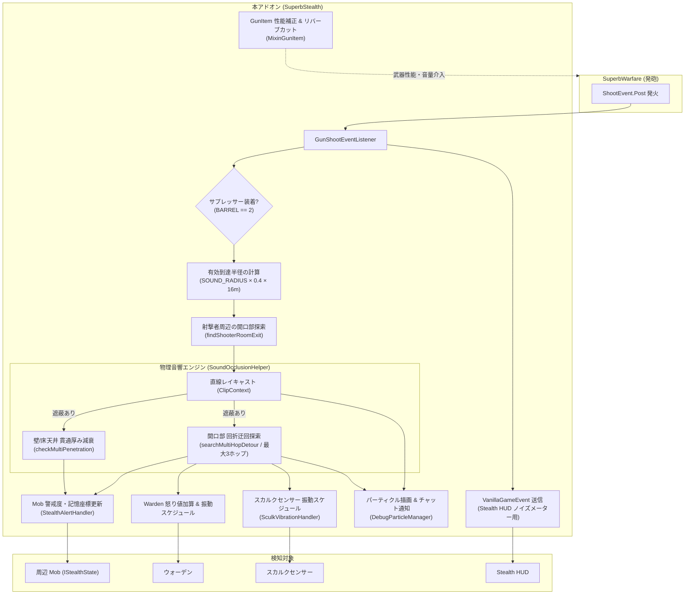

# SuperbWarfare × Stealth by Karl Karlmann 連携アドオン 技術仕様書・設計書

## 1. プロジェクト概要

### 1.1 目的
Minecraft 1.20.1 (Forge) 環境において、近代火器 Mod **「SuperbWarfare」** と ステルス・知覚拡張 Mod **「Stealth by Karl Karlmann」** を連携させ、現実的な音響伝播と隠密戦術を実現するアドオン Mod。

### 1.2 解決された課題
1. **銃声に対する Mob・ウォーデンの無反応**:
   - SuperbWarfare の発砲イベント（`ShootEvent.Post`）をフックし、銃ごとの到達半径に応じた物理音響シミュレーションを経て、周囲の Mob（Stealth Capability）およびウォーデンへ直接警戒・振動を伝達。
2. **壁・ドアを無視した単純伝播の排除**:
   - 壁や床天井の厚みに応じた貫通減衰と、開いたドアや通路を回り込む「最大3ホップの回折迂回探索」を実装。障害物の向こう側への音の届き方をリアルに計算。
3. **サプレッサーの戦術的トレードオフ**:
   - 音響半径を大幅カットし、遠距離リバーブ音をミュート。同時に集弾率、初速、連射速度（RPM）、反動、重量などの多面的な性能ペナルティを課すことが可能。
4. **足音と銃声の完全分離**:
   - Stealth Mod 側の標準検知距離（`base_hearing_range: 25`）を改変することなく、銃声のみ 60m〜90m 先まで伝播。

---

## 2. システムアーキテクチャ

---

## 3. モジュール別実装仕様

### 3.1 発砲検知と音響距離変換 (`GunShootEventListener`)
- **リスナ**: `ShootEvent.Post` (Forge EventBus)
- **距離計算**:
  SuperbWarfare の `GunProp.SOUND_RADIUS` は音量係数（Volume）であるため、Minecraft の標準音響到達距離式（$\text{distance} = \text{volume} \times 0.4 \times 16\text{m}$）を用いてブロック単位の半径に変換（フォールバック音量: 14.0 = 約89.6m）。
- **サプレッサー減衰**:
  サプレッサー装着時は `suppressorRadiusMultiplier`（標準 0.25 = 25%）を乗算（最低保証半径: 8.0m）。
- **HUD 連携**:
  バニラの 16m 制限通知を発火させず Stealth Mod の HUD ノイズメーターのみを跳ねさせるため、Forge EventBus に直接 `VanillaGameEvent(PROJECTILE_SHOOT)` を発行。

### 3.2 物理音響伝播エンジン (`SoundOcclusionHelper`)
1. **直接貫通（Multi-Penetration）**:
   - `ClipContext.Block.COLLIDER` による多重ブロック貫通レイキャスト。
   - ブロック衝突面（法線）から壁・床天井を判定し、それぞれの貫通厚み（m）× ペナルティ値（壁: 8m/ブロック、床天井: 12m/ブロック）を残存距離から減算。
2. **回折迂回（Multi-Hop Detour）**:
   - 直線ルートが遮蔽された場合、射撃者の部屋の出口（開いたドア等）および障害物周辺の開口部（空気ブロック、物理的に通過可能な開口部）を探索。
   - 最大3ホップ（`maxDetourHops`）まで分枝限定法（Branch and Bound）による枝刈り付き再帰探索を行い、最短・最強の迂回ルートを算出。
   - 貫通ルートと迂回ルートのうち、**Mob への到達残存音圧（remainingStrength）が高い方**を最終結果として採用。

### 3.3 Mob 警戒度・ウォーデン制御 (`StealthAlertHandler`)
- **Stealth Capability 連携**:
  - 到達残存音圧の比率（`strengthRatio`）に応じて、音源記憶優先度（`priority`: 5.0〜15.0）を算出。
  - 通常射撃: 即座に調査警戒度（`unsuppressedAlertLevel: 0.80`）へ遷移。
  - サプレッサー射撃: 残存音圧に応じた微小な警戒度加算（0.20〜0.50）、上限値（0.85）でキャップ。
- **ウォーデン制御**:
  - `increaseAngerAt` により射撃者への怒り値を直接加算（サプレッサー時は音圧連動、通常時は +10）。
  - `VibrationSystem.Listener#forceScheduleVibration` を呼び出し、振動感知アニメーションを確実に誘発。

### 3.4 スカルクセンサー連携 (`SculkVibrationHandler`)
- 到達半径内のチャンクを走査し、`SculkSensorBlockEntity` を抽出。
- センサー座標に対する音響遮蔽チェックを行い、音が到達した場合のみ `forceScheduleVibration` を発行。
- レッドストーン出力周波数（コンパレータ信号強度）:
  - サプレッサー射撃: 周波数 10（発射音相当）
  - 通常射撃: 周波数 15（爆発音相当・最強）

### 3.5 サプレッサー性能補正 & 音響調整 (`MixinGunItem`)
- **音響スケーリング**:
  `GunItem#playFireSounds` をフック。サプレッサー装着時は遠距離リバーブ音をキャンセルし、至近距離用の消音発砲音（`getFire3PSilent`）のみを、有効音響半径に合わせた音量にスケーリングして再生。
- **動的パラメータ補正**:
  `GunItem#modifyProperty` に介入し、サプレッサー装着時の倍率を適用：
  - 集弾率（`SPREAD`, `ZOOM_SPREAD_RATE`）
  - ダメージ（`DAMAGE`）
  - 初速（`VELOCITY`）
  - 連射速度（`RPM`）
  - 反動（`RECOIL`, `RECOIL_X`, `RECOIL_Y`）
  - 銃重量（`WEIGHT`）

### 3.6 ゲーム内音響可視化デバッグ (`DebugParticleManager` / `SuperbStealthCommands`)
- コマンド `/superbstealth debug` でプレイヤーごとにトグル切り替え。
- 直進到達（緑）、開口部迂回（黄マーカー & 黄ライン）、遮断・消音（赤マーカー & 赤ライン）を 5秒間（100 ticks）ワールド内にパーティクル描画。
- チャット欄に Mob ごとの到達結果・残存音圧・ホップ数をリアルタイム表示。

---

## 4. コンフィグ仕様 (`superbstealth-common.toml`)

| セクション | 項目名 | デフォルト値 | 説明 |
| :--- | :--- | :--- | :--- |
| `[occlusion]` | `floorCeilingPenalty` | `12.0` | 床・天井貫通時の距離減衰ペナルティ（m/厚） |
| `[occlusion]` | `wallPenalty` | `8.0` | 壁・閉じたドア貫通時の距離減衰ペナルティ（m/厚） |
| `[occlusion]` | `detourPenalty` | `2.0` | 開口部ホップごとの回折ペナルティ（m/ホップ） |
| `[occlusion]` | `maxDetourHops` | `3` | 最大回折ホップ数 |
| `[occlusion]` | `maxPenetrations` | `8` | 直線上の最大ブロック貫通数安全リミット |
| `[occlusion]` | `shooterExitScanRadius`| `4` | 射撃者周辺の開口部探索半径（ブロック） |
| `[gun]` | `suppressorRadiusMultiplier`| `0.25` | サプレッサー時の音響半径倍率（25%） |
| `[gun]` | `suppressorMinRadius` | `8.0` | サプレッサー時の最低保証到達半径（m） |
| `[gun]` | `fallbackGunVolume` | `14.0` | 銃声半径未定義時のフォールバック音量（約89.6m） |
| `[suppressor_modifier]` | `spreadMultiplier` | `1.10` | サプレッサー時の拡散倍率（+10%） |
| `[suppressor_modifier]` | `zoomSpreadRateMultiplier` | `1.0` | ADS 時の拡散補正倍率 |
| `[suppressor_modifier]` | `damageMultiplier` | `1.0` | 弾丸ダメージ倍率 |
| `[suppressor_modifier]` | `velocityMultiplier` | `1.0` | 銃口初速倍率 |
| `[suppressor_modifier]` | `rpmMultiplier` | `1.0` | 連射速度（RPM）倍率 |
| `[suppressor_modifier]` | `recoilMultiplier` | `1.0` | 反動倍率 |
| `[suppressor_modifier]` | `additionalWeight` | `0.0` | 追加銃重量 |
| `[stealth]` | `unsuppressedAlertLevel`| `0.80` | 通常射撃時の Mob 警戒度 |
| `[stealth]` | `suppressedMinAlertGain`| `0.20` | サプレッサー射撃時の最小警戒度増加量 |
| `[stealth]` | `suppressedMaxAlertGain`| `0.50` | サプレッサー射撃時の最大警戒度増加量 |
| `[stealth]` | `suppressedMaxAlert` | `0.85` | サプレッサー射撃時の警戒度上限キャップ |
| `[stealth]` | `soundPriorityMin` | `5.0` | 記憶優先度の最小値（足音と同等） |
| `[stealth]` | `soundPriorityMax` | `15.0` | 記憶優先度の最大値（至近距離） |
| `[sculk]` | `suppressedSculkFrequency` | `10` | サプレッサー時の振動周波数（信号強度 10） |
| `[sculk]` | `unsuppressedSculkFrequency`| `15` | 通常射撃時の振動周波数（信号強度 15） |

---

## 5. 開発・ビルド環境仕様

- **Minecraft**: 1.20.1
- **Minecraft Forge**: 47.4.28
- **Gradle**: 8.8 (Java Toolchain 17)
- **Java**: Java 17 (Temurin / Eclipse Adoptium 等)
- **マッピング**: Mojang Official (`official_1.20.1`)
- **ライセンス**: GNU General Public License v3.0 (GPL-3.0)
